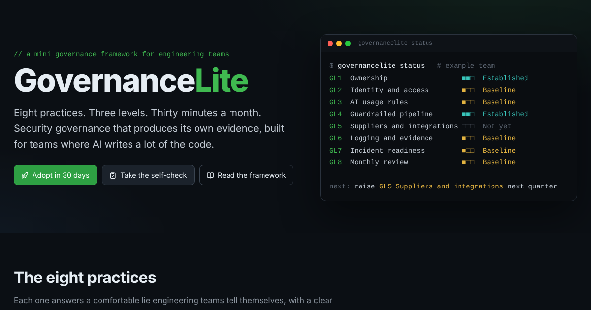

# GovernanceLite

**A mini governance framework for engineering teams.** Ten practices. Three levels. Thirty minutes a month. Security governance that produces its own evidence, built for teams where AI writes a lot of the code.

> **A practical start, not a replacement.** GovernanceLite isn't a replacement for robust frameworks such as ISO/IEC 27001, SOC 2 or the NIST Cybersecurity Framework. It's a practical starting point for engineering teams that aren't chasing a certification, or that want good habits in place before they do.

**Website:** https://samfernandoau.github.io/GovernanceLite/ (framework and self-check)



## The framework

| # | Practice | Outcome |
| --- | --- | --- |
| GL1 | [Ownership](framework/practices/01-ownership.md) | Everything has an owning team, or a decommission date |
| GL2 | [Identity and access](framework/practices/02-identity-and-access.md) | Every human and agent signs in as itself, with access that ends when the need ends |
| GL3 | [AI usage rules](framework/practices/03-ai-usage-rules.md) | Approved tools, clear data rules, and a human accountable for what ships |
| GL4 | [Secure design](framework/practices/04-secure-design.md) | Significant changes get a short threat model before code is written |
| GL5 | [Guardrailed pipeline](framework/practices/05-guardrailed-pipeline.md) | Every change reaches production through a protected path with fast, risk-ranked checks |
| GL6 | [Data protection](framework/practices/06-data-protection.md) | You know what sensitive data you hold, keep only what you need, and keep it out of test |
| GL7 | [Suppliers and integrations](framework/practices/07-suppliers-and-integrations.md) | Every third party, OAuth app and extension that touches your code or data has an owner |
| GL8 | [Logging and evidence](framework/practices/08-logging-and-evidence.md) | You can answer "who accessed what, when, from where?" |
| GL9 | [Incident readiness](framework/practices/09-incident-readiness.md) | A one-page plan that works at 2 AM |
| GL10 | [Monthly review](framework/practices/10-monthly-review.md) | 30 minutes a month that keeps the other nine alive |

Each practice has three levels (**Baseline**, **Established**, **Evidenced**), a metric, a cadence, and a mapping (direct or partial) to ISO/IEC 27001:2022, SOC 2, the ASD Essential Eight and the OWASP Top 10.

**Start here:** [Framework overview](framework/README.md) · [Adopt in 30 days](framework/adopt-in-30-days.md) · [Maturity levels](framework/maturity-levels.md)

## Repository layout

```text
framework/                 ← the framework: single source of truth (Markdown)
├── README.md              overview, principles, roles
├── practices/             GL1–GL10
├── adopt-in-30-days.md
├── maturity-levels.md
├── metrics.md
├── mappings.md            ISO 27001, SOC 2, Essential Eight, OWASP
└── faq.md

LICENSE                    CC BY 4.0, for the framework text
LICENSE-CODE               MIT, for the website code
THIRD-PARTY-NOTICES.md     Lucide icon licence

index.html, assets/        ← the framework website (renders framework/*.md in the browser)
```

The website reads the Markdown in `framework/` directly, so **editing a `.md` file updates the site**. There's no build step and no generator to maintain. The checklists in each practice page power the interactive self-check.

## Using GovernanceLite in your team

1. Read the [overview](framework/README.md) and the ten practice pages (about 30 minutes).
2. Score your team with the [self-check](https://samfernandoau.github.io/GovernanceLite/#/self-check). It's saved only in your browser and exports Markdown.
3. Follow [Adopt in 30 days](framework/adopt-in-30-days.md) to reach Level 1 everywhere.
4. Run the monthly review, and raise one practice per quarter.

## Origin

GovernanceLite was introduced in the talk *The Build Passed. The Hackers Don't Care.* (Sam Fernando, DDD Adelaide 2026). The slides live in their own repository: https://samfernandoau.github.io/the-build-passed/

## Practising what it preaches

- No frameworks, no build step, no web fonts, no third-party scripts or trackers
- Content Security Policy allowing only the site's own scripts
- A static site with nothing to build, so there's no pipeline to poison. When you do run pipelines, [GL5](framework/practices/05-guardrailed-pipeline.md) covers pinning actions to a full commit SHA and least-privilege tokens.

## Running locally

```sh
python3 -m http.server 8000
# open http://localhost:8000
```

A local web server is needed because the site fetches the Markdown files.

## Publishing

GitHub Pages serves the `main` branch directly (**Settings → Pages → Deploy from a branch → `main` / root**). There's no build step; `.nojekyll` tells Pages to serve the files as they are. Pushes to `main` go live within a minute or two.

## Licence

© 2026 Sam Fernando.

- **The framework** (everything in `framework/`, and the text of the website) is licensed under [Creative Commons Attribution 4.0 International (CC BY 4.0)](LICENSE). You can copy, adapt and share it, including commercially and inside your own policies, as long as you credit "GovernanceLite by Sam Fernando" and link back here.
- **The website code** (`index.html`, `assets/`) is licensed under the [MIT License](LICENSE-CODE).
- **Icons** are from [Lucide](https://lucide.dev), under the ISC licence (some derived from Feather, MIT). See [THIRD-PARTY-NOTICES.md](THIRD-PARTY-NOTICES.md).

GovernanceLite is an independent project. It isn't affiliated with or endorsed by ISO, IEC, the AICPA (SOC 2), the Australian Signals Directorate or OWASP. Their names are used only to describe how the practices relate to their frameworks.
